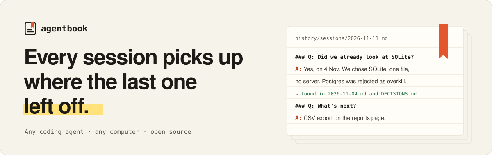
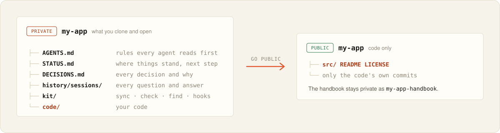

<p align="center">
  <picture>
    <source media="(prefers-color-scheme: dark)" srcset="assets/banner-dark.svg">
    
  </picture>
</p>

<p align="center">
  Your coding agent forgets everything between sessions. <b>Agentbook doesn't.</b><br>
  One private repo holds your code and its handbook, and any agent on any computer picks up where the last one left off.
</p>

<p align="center">
  <a href="https://enigmaticzee.github.io/agentbook"><b>Website</b></a> ·
  <a href="#-install">Install</a> ·
  <a href="#-the-routine">The routine</a> ·
  <a href="#-scenarios">Scenarios</a> ·
  <a href="#-the-cli">CLI</a> ·
  <a href="#-whats-inside">What's inside</a>
</p>

<p align="center">
  <a href="LICENSE"></a>
  <a href="https://github.com/EnigmaticZee/agentbook/actions/workflows/test.yml"></a>
  
</p>

<br>

## ✦ The idea

Every project becomes **one private repo you clone and open**. It holds the code *and* a handbook: what the
project is, where it stands, every decision and why, every question you asked and what the answer was. Rules
in `AGENTS.md` make your agent read it first and keep it current as it works. Git hooks make sure it does.

<p align="center">
  <picture>
    <source media="(prefers-color-scheme: dark)" srcset="assets/layout-dark.svg">
    
  </picture>
</p>

- **Private projects stay one repo.** Handbook and code together, for as long as you like.
- **Public projects become two.** Only the code's own commits go public. Your notes never do.
- **Same routine either way**, with Claude Code, Codex, Cursor, GitHub Copilot, Gemini CLI, Amp, Jules, Zed, or
  anything else that reads `AGENTS.md`.

<br>

## ✦ Install

<table>
<tr><td><b>Homebrew</b></td><td><code>brew install enigmaticzee/tap/agentbook</code></td></tr>
<tr><td><b>One line</b></td><td><code>curl -fsSL https://enigmaticzee.github.io/agentbook/install | sh</code></td></tr>
<tr><td><b>Go</b></td><td><code>go install github.com/EnigmaticZee/agentbook/cmd/agentbook@latest</code></td></tr>
<tr><td><b>Nothing</b></td><td>Paste this into any coding agent:<br><code>Set up an agentbook for this project using github.com/EnigmaticZee/agentbook; follow its PROMPT.md.</code></td></tr>
</table>

Then run `agentbook init` in a new or existing project folder, open it in your agent and say
**"Read AGENTS.md and finish setting up this agentbook."** Needs `git` and `bash`.

<br>

## ✦ The routine

<table>
<tr>
<td align="center" width="25%"><h3>1</h3><b>Open</b><br><sub>Open the project folder in your agent.<br>New computer? Clone your private repo first.</sub></td>
<td align="center" width="25%"><h3>2</h3><b>Work</b><br><sub>Say what you want.<br>Ask anything about the past.</sub></td>
<td align="center" width="25%"><h3>3</h3><b>Save</b><br><sub>Say<br><code>commit and push</code></sub></td>
<td align="center" width="25%"><h3>4</h3><b>Stop</b><br><sub>Say<br><code>wrap up</code></sub></td>
</tr>
</table>

> [!TIP]
> "Wrap up" is the one habit that matters: it makes sure everything from the session, including
> conversations where no code changed, reaches your next computer.

<br>

## ✦ Scenarios

Every scenario starts with something you say to your agent. Click one to open it.

<details>
<summary><b>🌱&nbsp; Start a brand-new project</b></summary>
<br>

Run `agentbook init` in an empty folder, or open the folder in your agent and say:

> **Set up an agentbook for this project using github.com/EnigmaticZee/agentbook; follow its PROMPT.md.**

You get one repo with the handbook and an empty `code/` folder. Nothing goes online until you decide.
</details>

<details>
<summary><b>📦&nbsp; Add it to a project you already have</b></summary>
<br>

Same as above, inside the project. It tells you before moving anything: the folder keeps its path, your code
moves into `code/` with its full history and local files, and the agent writes the handbook from the code,
its history and any notes you had.
</details>

<details>
<summary><b>🔒&nbsp; Put it on GitHub, privately</b></summary>
<br>

> **Put this project on private GitHub.**

You get **one private repo**, `<project>`, with the handbook and the code. It can stay like this forever.
</details>

<details>
<summary><b>🌍&nbsp; Make it public</b></summary>
<br>

> **Get this ready to go public.**

1. It shows you exactly what would be published: only the code's own history. Your notes and handbook
   commits are never included.
2. It audits that for secrets, personal paths, private files and unexpected identities, and goes through
   each finding with you.
3. Only after your yes: your private repo becomes `<project>-handbook`, a public `<project>` is created with
   just the code, and your workspace switches over. Notes and hooks stay private and keep working.
</details>

<details>
<summary><b>⏳&nbsp; Private for a while, then public</b></summary>
<br>

Nothing special: keep it private as long as you like, then say *"Get this ready to go public."* Code and notes
are always committed separately, so the code's history comes out clean. From then on:

- **New computer:** clone `<project>-handbook`; the agent fetches the public code into `code/`.
- **"Commit and push":** the code goes to the public repo and the handbook to the private one, in one step.
</details>

<details>
<summary><b>💻&nbsp; A new computer, or you deleted the folder</b></summary>
<br>

1. Clone your private repo: `<project>` if it's one repo, `<project>-handbook` once the code is public.
2. Open it in your agent and say what you want.

The agent fetches anything missing, installs what it can and connects everything before it starts. On a
brand-new computer it may ask you to do a one-time step it can't (install an app, sign in to GitHub).
</details>

<details>
<summary><b>🔎&nbsp; Ask about something from before</b></summary>
<br>

Just ask:
> *Did we look into X?* · *Why did we drop Y?* · *What did we find about Z?*

The agent searches the handbook and every session log, and answers with where it came from. If something was
never discussed, it says so plainly instead of guessing. Or search yourself: `agentbook find`.
</details>

<details>
<summary><b>🤝&nbsp; Someone else contributes</b></summary>
<br>

Public projects: nothing to do. They clone only the public code; your handbook and hooks don't exist for them.
</details>

<details>
<summary><b>🙈&nbsp; Keep AI traces out of your published code (optional)</b></summary>
<br>

Some people want their public code to show only their own name. Set `HIDE_AI_TRACES="yes"` in
`agentbook.conf` (or answer yes in `agentbook init`) and code pushes are blocked when they contain AI tool
names, "generated with" or co-author lines, AI config folders like `.claude/`, or any commit identity but
yours. Off by default.
</details>

<details>
<summary><b>⬆️&nbsp; Upgrade a project to a newer kit</b></summary>
<br>

Run `agentbook upgrade` in the project, or say **"Upgrade the agentbook kit."**
</details>

<details>
<summary><b>🗄️&nbsp; Retire a project</b></summary>
<br>

> **Retire this project.**

Its repos are archived (not deleted) and a final status is written.
</details>

<br>

## ✦ What happens on its own

| | Enforced automatically, whatever agent you use |
| :-: | --- |
| 🔄 | At the start of every session the agent syncs: fetches or updates the code and the handbook |
| 📝 | Every code commit is logged in the handbook |
| 🧱 | In a one-repo project, a commit can't mix code and notes, so the code's history stays publishable |
| 🛑 | A push is **blocked** if the handbook is behind the code, today's session log is missing, or the tests fail |
| 🚚 | The handbook travels with the code: one push updates both |
| 🙈 | Agent rule files inside `code/` are local links, never committed to the code |

**Still up to the agent** (the rules in `AGENTS.md` cover it): how thorough the notes are, logging
conversations where nothing was pushed (that's why you say "wrap up"), and looking things up before
answering.

<br>

## ✦ The CLI

Your agent runs the kit scripts for you. The `agentbook` command is for the moments that are yours:

| Command | What it does |
| --- | --- |
| `agentbook` | Interactive menu: where things stand, and every action a keypress away |
| `agentbook init` | Create a workspace for a new or existing project (a short guided form) |
| `agentbook status` | Next step, latest decisions and the last session at a glance |
| `agentbook find [words]` | Search everything recorded; with no words, a live search box |
| `agentbook check` | Is everything saved, pushed, logged and tested? |
| `agentbook doctor` | Look for problems on this computer and in this workspace |
| `agentbook upgrade` | Update a workspace's `kit/` to this version |
| `agentbook prompt --copy` | Copy the setup prompt for any coding agent |

It's a single small binary (Go, [Bubble Tea](https://github.com/charmbracelet/bubbletea) and
[Lip Gloss](https://github.com/charmbracelet/lipgloss)) with the kit built in. It reads light and dark terminals
on its own; set `AGENTBOOK_THEME=light` or `dark` to choose, and `NO_COLOR=1` for plain output.

<br>

## ✦ If something goes wrong

| You see | Say |
| --- | --- |
| The agent says the sync failed | *"Sort out the sync."* Nothing is ever lost. |
| A push is blocked | Usually nothing; it fixes the cause. To push anyway: *"push without the checks this time"*. |
| The agent doesn't seem to know the project | *"Read AGENTS.md and follow it."* |
| You want to be sure everything is saved | *"Run the check"*, or `agentbook check` yourself. |

<br>

## ✦ What's inside

```
agentbook/
├── PROMPT.md       what an agent follows to set up or repair a project
├── install.sh      creates a workspace (new or existing project) or upgrades one
├── kit/            copied into every project
│   ├── sync.sh  setup.sh  check.sh  find.sh  log.sh
│   ├── public-audit.sh  go-public.sh
│   └── hooks/      pre-commit  post-commit  pre-push
├── templates/      starting versions of every handbook file
├── cmd/, internal/ the agentbook CLI (Go)
├── docs/           the website
└── test/run.sh     every scenario, tested on throwaway repos
```

<details>
<summary><b>A project, once set up</b></summary>
<br>

```
my-app/               ← clone this, open it in your agent
├── AGENTS.md          rules every agent reads first (CLAUDE.md, GEMINI.md link to it)
├── README.md          how to work on this project
├── STATUS.md          where things stand, what's next
├── DECISIONS.md       every decision, why, and what was rejected
├── HISTORY.md         the story so far
├── ARCHITECTURE.md    how it's built
├── agentbook.conf     settings: layout, test command, identity…
├── history/sessions/  every conversation: questions, answers, research
├── kit/               scripts and hooks
└── code/              the code
```
</details>

<details>
<summary><b>Settings (<code>agentbook.conf</code>)</b></summary>
<br>

| Setting | What it's for |
| --- | --- |
| `STAGE` | `local`, `private` or `public`: where the code lives |
| `LAYOUT` | `single` (one repo) or `split` (code in its own repo) |
| `CODE_REMOTE`, `HANDBOOK_REMOTE` | where each repo lives once it's on GitHub |
| `GIT_NAME`, `GIT_EMAIL` | the commit identity for both repos on every computer |
| `TEST_CMD` | one command that runs every test, from inside `code/` |
| `AGENT_FILES` | agent entry files linked to `AGENTS.md` (default `AGENTS.md CLAUDE.md GEMINI.md`) |
| `REQUIRE_CMDS`, `INSTALL_CMD`, `MANUAL_SETUP` | what a new computer needs |
| `HIDE_AI_TRACES` | optional guard against AI tool traces in pushed code (default `no`) |
</details>

<br>

## ✦ Contributing

Issues and pull requests are welcome. Run the tests before sending a change:

```bash
bash test/run.sh && go test ./...
```

`test/run.sh` walks every scenario (new project, private, new computer, two computers, contributors, going
public, adopting an existing repo, upgrades) on throwaway repos, with bare repos standing in for GitHub.

<br>

<p align="center">
  Made by <a href="https://github.com/EnigmaticZee"><b>H. Wren</b></a> (@EnigmaticZee) · <a href="LICENSE">MIT licence</a>
</p>
